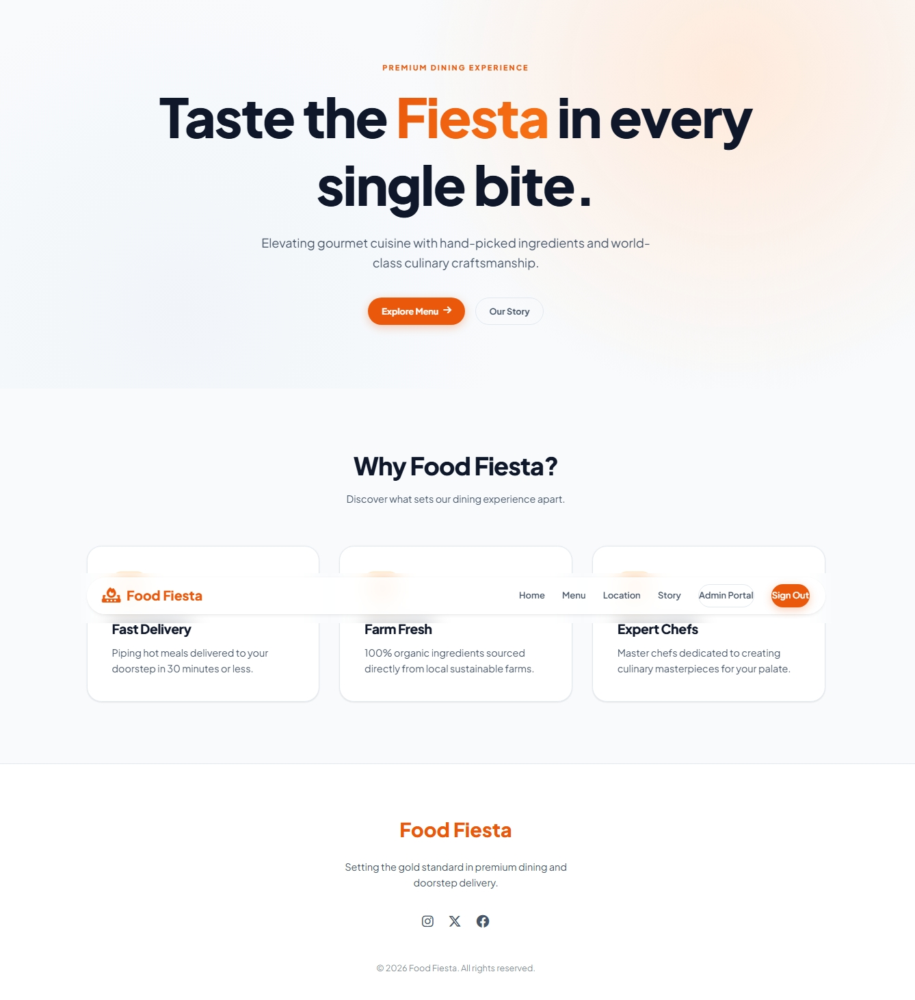
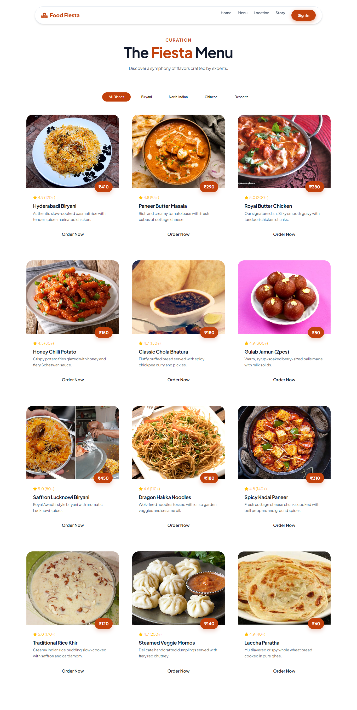
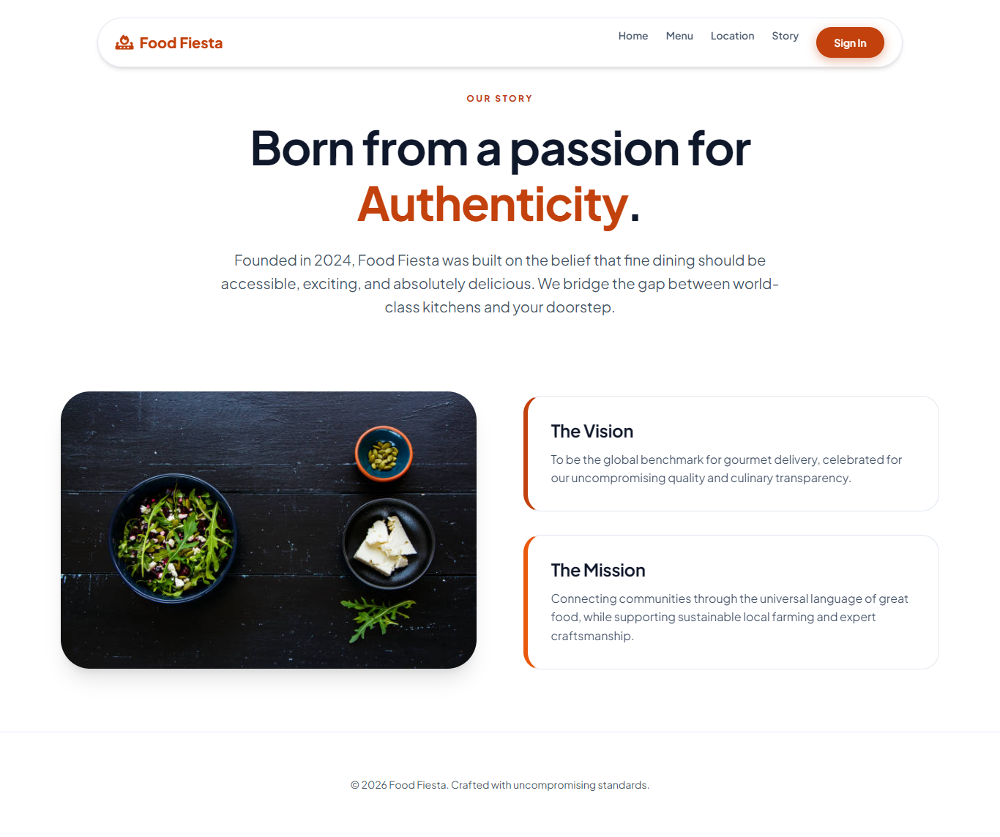
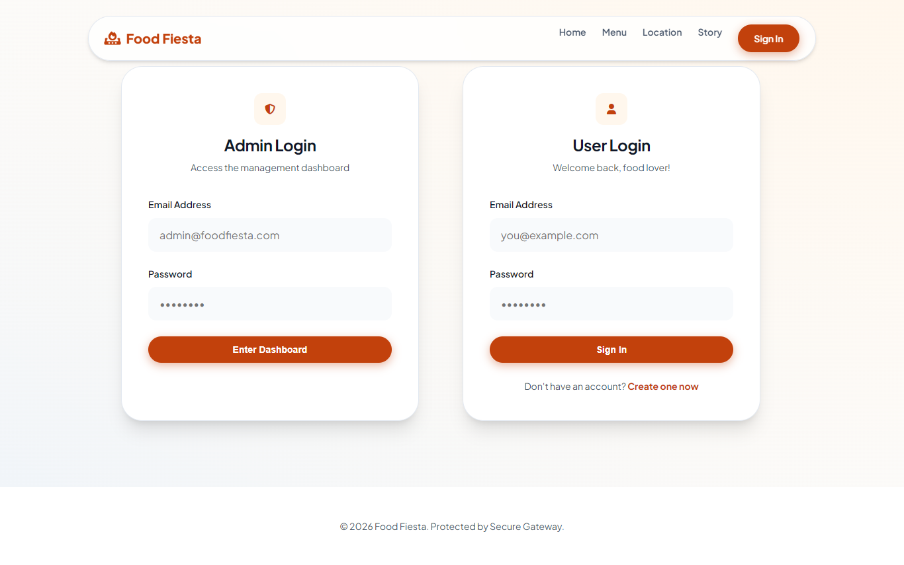
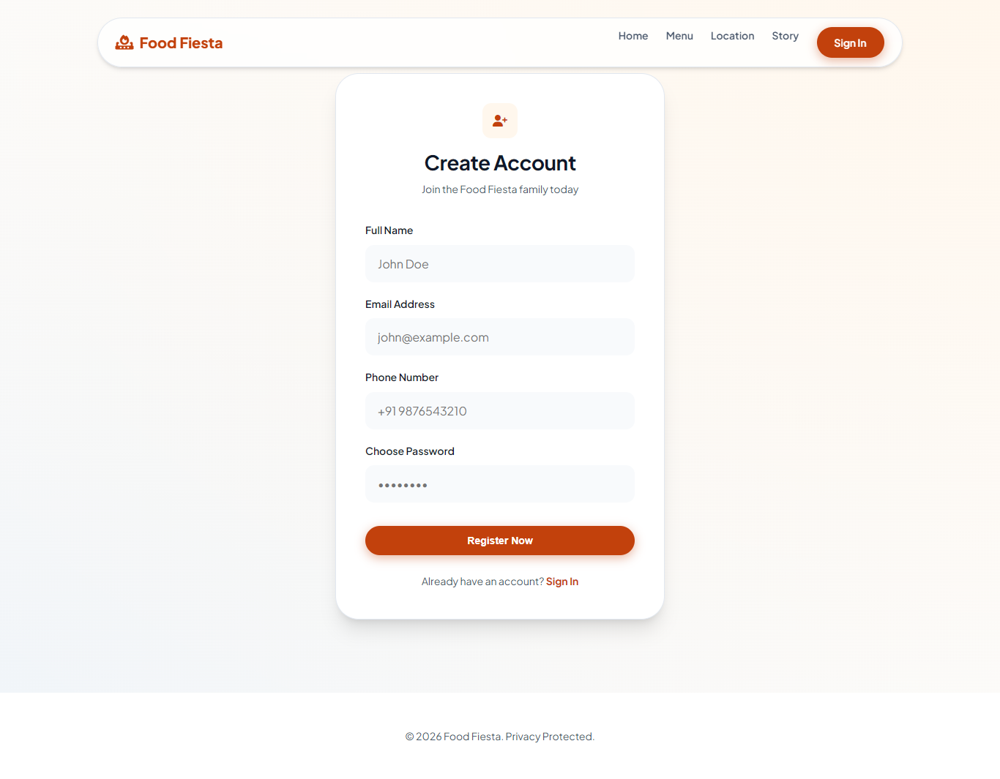
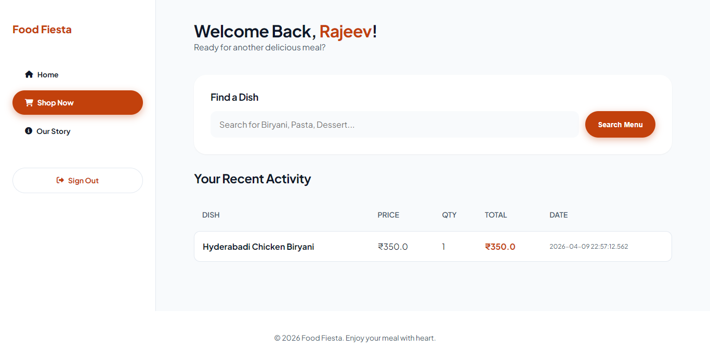
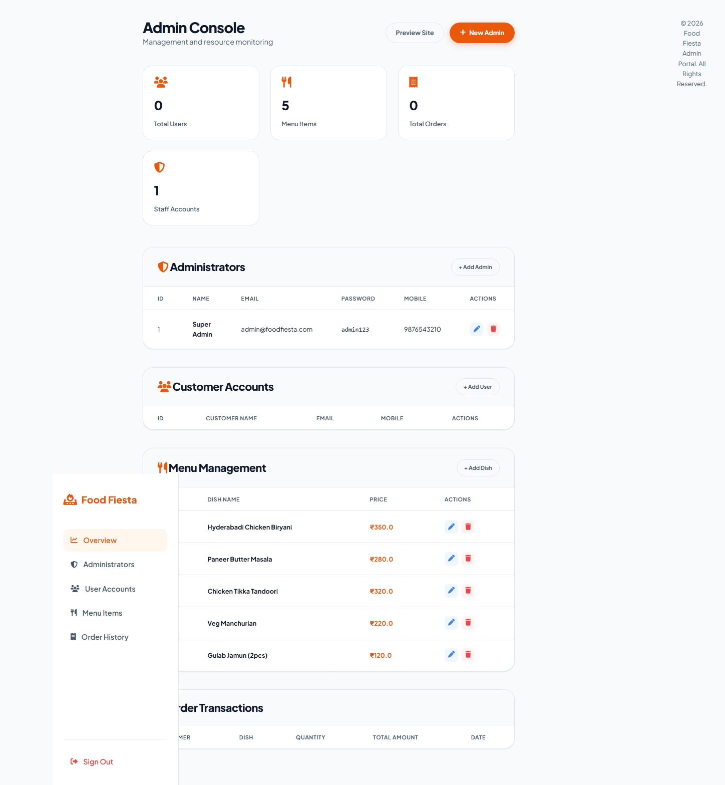
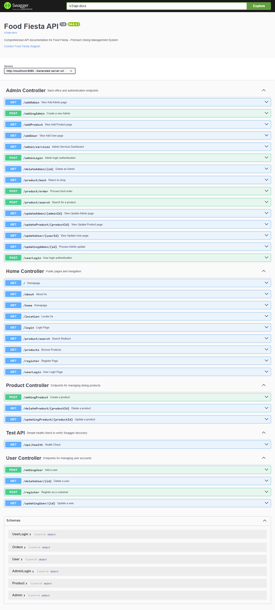

# 🍕 Food Frenzy - Production-Grade Full-Stack Dining Platform

[](https://spring.io/projects/spring-boot)
[](https://www.oracle.com/java/)
[](https://www.thymeleaf.org/)
[](https://www.postgresql.org/)
[](LICENSE)

Welcome to **Food Frenzy**, a modern, high-performance gourmet dining management and online ordering platform. Engineered with **Spring Boot 3.4.2** and **Java 21**, this application is designed for cloud-native deployment, supporting both fast zero-config in-memory development (H2) and enterprise persistent storage (PostgreSQL).

---

## ✨ Key Features

- 🌓 **Dual-Theme Support (Dark Mode & Aesthetic White Mode)**: 
  - Integrated theme engine with instant hydration preventing theme flicker (FOUC).
  - Smooth `0.3s` easing transitions across surfaces, cards, borders, and typography.
  - User preference persistence saved seamlessly in `localStorage`.
  - Accessible theme toggle button available across all navigation bars, customer consoles, and admin dashboards.
- 🛒 **End-to-End Ordering & Cart Management**:
  - Dynamic category-filtered menu catalog (Biryani, North Indian, Chinese, Beverages).
  - Interactive shopping cart with quantity modifications and real-time total settlement.
  - Dedicated order confirmation receipts and transaction ledger.
- 🔐 **Enterprise Security & Authentication**:
  - Spring Security filter chain with role-based access control (Customers vs. Administrators).
  - Social authentication via **Google OAuth 2.0**.
  - Encrypted password credential protection.
- 👤 **Customer & Administrative Consoles**:
  - **Customer Portal**: Personalized profile dashboard, order history, and instant reordering.
  - **Admin Control Operations**: Full CRUD controls to add/edit catalog dishes, inspect registered users, and provision administrative nodes.
- 🛠️ **OpenAPI 3 / Swagger Documentation**:
  - Fully documented interactive API endpoints via Swagger UI.
- 🗄️ **Dual Database Engine**:
  - Ready-to-run zero-setup in-memory database (H2) with automated sample data seeding on startup.
  - Full production persistence compatibility with PostgreSQL.

---

## 🏗️ Architecture & Technology Stack

The application adheres to clean **layered architecture** design principles:

- **Presentation Layer (Thymeleaf, CSS3, JavaScript)**: Server-side HTML rendering utilizing custom visual utility classes, glassmorphic UI elements, dynamic theme switching, and responsive layouts.
- **Controller Layer (Spring Web)**: RESTful APIs and traditional Web MVC routing controls handling requests, user session binding, and OAuth flows.
- **Service Layer (Spring Component)**: Business logic, cart state calculations, and order handlers.
- **Data Access Layer (Spring Data JPA / Hibernate)**: Object-Relational Mapping (ORM) translating domain entities directly to database tables.
- **Security Filter Chain (Spring Security)**: Built-in filters handling OAuth2, CSRF/CORS policy setup, endpoint authorizations, and resource control.

### Layer Diagram
```text
[ Browser / Client ] ──▶ [ Controller / MVC ] ──▶ [ Services Layer ] ──▶ [ JPA Repositories ] ──▶ [ Database ]
                                │                                                 │
                                ▼                                                 ▼
                      [ Thymeleaf Templates ]                             [ H2 / PostgreSQL ]
```

---

## 🖥️ Application Preview

### 🏠 Home Page
<p align="center">
  
</p>

### 🍛 Interactive Menu Grid
<p align="center">
  
</p>

### 📖 Story & About Page
<p align="center">
  
</p>

### 🔑 Authentication Systems
<p align="center">
  
  
</p>

### 👤 Customer & Admin Dashboards
<p align="center">
  
  
</p>

### 🛠️ Swagger API Documentation
<p align="center">
  
</p>

---

## 📋 Prerequisites

Before running or deploying the project, ensure you have the following installed:
- **Java Development Kit (JDK) 21** (or Java 17+)
- *Note: Maven is not required to be installed separately; the Maven Wrapper (`mvnw` / `mvnw.cmd`) is pre-bundled in the repository.*

---

## ⚙️ Environment Variables Registry

| Variable Name | Purpose | Example Value / Default |
| :--- | :--- | :--- |
| `JAVA_HOME` | Points to your Java installation directory | `C:\Program Files\Java\jdk-21` |
| `PORT` | Web port Spring Boot listens on | `8080` |
| `SPRING_DATASOURCE_URL` | JDBC database connection string | `jdbc:postgresql://localhost:5432/foodfrenzy` |
| `SPRING_DATASOURCE_USERNAME` | Database username credentials | `postgres` |
| `SPRING_DATASOURCE_PASSWORD` | Database password credentials | `your_password` |
| `GOOGLE_CLIENT_ID` | Google OAuth Web App Client ID | `your_client_id.apps.googleusercontent.com` |
| `GOOGLE_CLIENT_SECRET` | Google OAuth Web App Client Secret | `GOCSPX-your_secret` |

---

## 🚀 Local Quick-Start (H2 In-Memory)

### 1. Clone the Repository
```bash
git clone https://github.com/abhishek8678/Food-Frenzy.git
cd Food-Frenzy
```

### 2. Configure Local Credentials (Optional)
To test Google OAuth2 login locally, copy `.env.example` to `.env`:
```env
GOOGLE_CLIENT_ID=your_id_here.apps.googleusercontent.com
GOOGLE_CLIENT_SECRET=your_secret_here
```
*(Default fallback placeholders are built in if OAuth is not configured).*

### 3. Run Locally

- **Windows (PowerShell)**:
  ```powershell
  .\mvnw.cmd spring-boot:run
  ```
  *(If your system defaults to Java 17 while JDK 21+ is in another directory, run:)*
  ```powershell
  $env:JAVA_HOME = 'C:\Program Files\Java\jdk-25'
  $env:PATH = "C:\Program Files\Java\jdk-25\bin;$env:PATH"
  .\mvnw.cmd spring-boot:run
  ```

- **macOS / Linux**:
  ```bash
  ./mvnw spring-boot:run
  ```

### 4. Access URLs
- **Web Application**: [http://localhost:8080/](http://localhost:8080/)
- **Menu Catalog**: [http://localhost:8080/products](http://localhost:8080/products)
- **Swagger Documentation**: [http://localhost:8080/swagger-ui/index.html](http://localhost:8080/swagger-ui/index.html)
- **H2 Database Console**: [http://localhost:8080/h2-console](http://localhost:8080/h2-console)
  - **JDBC URL**: `jdbc:h2:mem:foodfrenzy`
  - **Username**: `sa`
  - **Password**: *(leave blank)*

---

## 🔑 Default Administrator Credentials

On startup, the system automatically initializes sample menu items and provisions a default administrative node:
- **Email**: `admin@foodfrenzy.com`
- **Password**: `admin123`

---

## 🗄️ Database Configurations

### Option A: Local Quick Dev (H2 In-Memory - Default)
The application starts out-of-the-box with H2 in-memory storage. All tables and seed data are initialized automatically.

### Option B: Persistent Database (PostgreSQL)
To run with PostgreSQL persistence locally or in production, configure environment variables or update `src/main/resources/application.properties`:
```properties
spring.datasource.url=jdbc:postgresql://localhost:5432/foodfrenzy
spring.datasource.username=postgres
spring.datasource.password=YOUR_PASSWORD
spring.jpa.hibernate.ddl-auto=update
```

---

## 🐳 Docker Containerization

1. **Build the production Docker image**:
   ```bash
   docker build -t food-frenzy .
   ```

2. **Run container**:
   ```bash
   docker run -p 8080:8080 food-frenzy
   ```

---

## ☁️ Cloud Deployment (Render & Docker)

Render parses the project's root `Dockerfile` to compile and containerize the application automatically:
1. Navigate to your **Render Dashboard** and click **New > Web Service**.
2. Connect your `Food-Frenzy` GitHub repository.
3. Select **Docker** as the Runtime environment.
4. Under **Advanced Settings**, configure environment variables (`PORT=8080`, plus database and OAuth keys if using PostgreSQL/Google Login).
5. Click **Create Web Service**.

---

## 📄 License
This project is open-source and distributed under the [MIT License](LICENSE).
